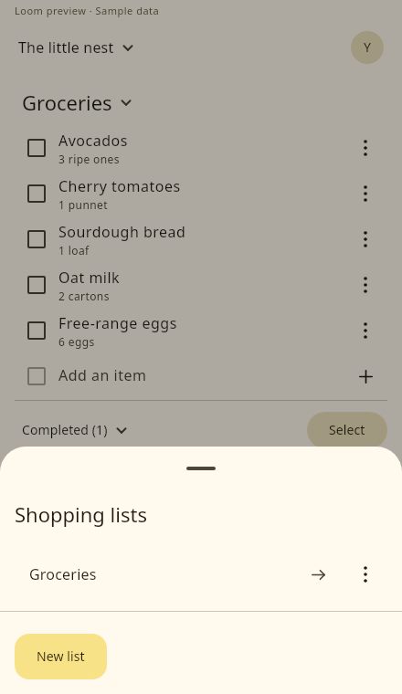
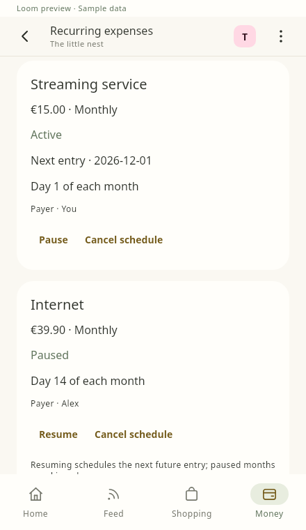
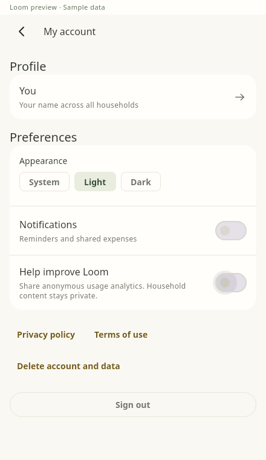

# Loom

**Life, woven together.** A Kotlin Multiplatform household companion for roommates and couples on Android and iOS, with shared Compose UI and a Supabase backend.

Application ID and iOS bundle ID: **`com.eyther.lumbridge`**.

 

Flows: [More](docs/screenshots/more-light.png), [All reminders](docs/screenshots/reminders-light.png), [Shopping checklist](docs/screenshots/shopping-light.png), [Trip balances](docs/screenshots/trip-balances-light.png), [Unequal split](docs/screenshots/split-shares-light.png), and [Repayment](docs/screenshots/repayment-light.png).

Editing sheets: [Shopping on a short screen](docs/screenshots/shopping-sheet-narrow.png), [Nickname](docs/screenshots/nickname-sheet-light.png), and [dark mode](docs/screenshots/nickname-sheet-dark.png).

Authentication screenshots: [Sign in](docs/screenshots/auth-login-light.png), [Create account](docs/screenshots/auth-register-light.png), and [Verification](docs/screenshots/auth-verification-light.png).

## What’s included

- Google sign-in, separate email login/registration/verification screens, password visibility controls, and code resend with a cooldown. Existing accounts can also request an email sign-in code.
- Separate household selection, creation and invitation-joining screens, each with its own ViewModel.
- Home, Shopping, Balances and More tabs, with square Home quick actions and full Reminders/Feed destinations under More. Household selection and global My account follow Plannot’s portal pattern.
- Multiple households, owner invitations, quick switching, and restoring the last accessible household. My account is available before the first household exists.
- Named shared shopping lists with inline Enter-to-add, collapsed completed items, optional editing, undo, favorites, moving items, and list rename/archive/restore.
- Household reminders, daily/weekly repeats, timezone handling, and completion.
- Independent Everyday and trip/event accounts with one currency each and household-member participants.
- Dedicated expense entry/detail/editing, equal/weighted-share/exact-amount/percentage splits, who-pays-whom balances and repayments.
- Monthly recurring expense schedules with payment dates, pause/resume/cancel controls, monthly reports, statistics, CSV export, and immutable statement revisions.
- RSS/Atom subscriptions with per-user read state and scheduled server refreshes.
- Light, dark, and system themes using the Loom gold and yarn branding.
- Supabase Edge Functions for FCM/APNs push delivery, retries, device rotation, and scheduled household work.
- A dedicated desktop preview with isolated demo data sources and sample households. Production screens and data sources contain no demo branches.
- Feature-owned string/plural resources, localized validation messages, accessibility labels, and named Gradle project references.
- Optional Android Firebase Analytics with explicit consent, no household content in events, and advertising identifiers disabled.
- Public privacy, terms and account-deletion pages linked from authentication and My account, plus signed Firebase builds and explicit Play internal-draft releases with GitHub release tags.

Recurring schedules generate monthly expense records; repayments record money you have already sent or received. Pausing skips future entries, resuming skips paused months, and cancellation preserves recorded expense history.

The [product roadmap](docs/product-roadmap.md) records delivered work and following milestones. Offline functionality is deferred. See the [architecture and localization audit](docs/implementation-audit.md).

## Architecture

Loom adapts [Plannot’s](https://github.com/Plannot/plannot-app) architecture and reuses its flow lifecycle helpers, navigation state, navigator, and transition wrappers:

```text
Host → Screen → ViewModel Contract + Implementation → UseCase → DataSource
```

There is one Gradle module per feature. `domain`, `data`, and `presentation` are **packages inside each feature**, with no layer-specific Gradle submodules.

```text
androidApp/                  Android application and FCM integration
iosApp/                      Native SwiftUI host, APNs delegate, Xcode project
desktopApp/                  Development preview for the shared UI
shared/
  core/                      Generic utilities, encrypted storage, transport, theme, navigation
  entrypoint/                App entry points, navigation Hosts, iOS framework
    .../app/demo/            Dedicated preview entry point, fixtures, and demo port implementations
  di/                        Central annotated application/household providers and graph assembly
  features/
    authentication/          domain/ · data/ · presentation/
    account/                 domain/ · data/ · presentation/
    household/               domain/ · data/ · presentation/
    home/                    domain/ · presentation/
    shopping/                domain/ · data/ · presentation/
    reminders/               domain/ · data/ · presentation/
    expenses/                domain/ · data/ · presentation/
    feed/                    domain/ · data/ · presentation/
    insights/                domain/ · data/ · presentation/
    settings/                domain/ · data/ · presentation/
    analytics/               domain/ · data/ · presentation/
    legal/                   domain/ · data/ · presentation/
supabase/                    Versioned schema, functions, schedules, database integration tests
```

Screens collect lifecycle-aware state and pass individual values/callbacks to `Inner*Screen`. ViewModels use private `InnerInputState` and Plannot’s `observeWith` helpers. DataSource interfaces live in domain; `Common*` implementations own I/O and translate server failures into typed domain errors. Streams use `stream()` and `Get…StreamUseCase`; request/response DTOs and mappers have separate files. The dedicated `shared/di` module follows Plannot's annotated provider pattern with `@Module`, `@Single` and `@KoinViewModel` bound to contracts. Koin's compiler plugin processes these providers; feature classes contain no DI registrations.

Models stay in their owning feature: household owns `HouseholdContextDomain`, expenses owns `MoneyDomain`, and other features depend on those domains directly. Core has no feature dependencies. Sample data, settings preferences, notification registration, statement exports, and app-specific routes also stay with their respective owners. See the ownership table in [architecture details](docs/architecture.md).

See [architecture details](docs/architecture.md), [screen and interaction language](docs/design-language.md), and [backend setup](docs/backend.md).

For the [changelog](CHANGELOG.md), automatic versioned release notes and 4.0.x versions, Firebase distribution, Android signing, required secrets, Play uploads and public policy URLs, follow [Play Store release setup](docs/play-store-release.md). See the [data-safety worksheet](docs/data-safety.md) and [support-assisted account-deletion runbook](docs/account-deletion.md).

## Run

Use JDK 23, Android Studio with AGP 9.4 support, Android SDK 37, and Xcode on a Mac for iOS. Dependency versions are pinned in `gradle/libs.versions.toml`; the Gradle wrapper is included.

1. Open the repository in Android Studio.
2. Add your Android SDK path to `local.properties` if the IDE has not done so.
3. Run the `androidApp` configuration, or build:

   ```sh
   ./gradlew :androidApp:assembleDebug
   ```

The app uses Loom’s live project through `config/loom-public.properties`, which contains only its public URL and publishable client key. To use a different project, copy `loom.properties.example` to the gitignored `loom.properties`; environment variables override both files. Server secret keys are rejected by the build.

Email-code authentication requires the signup and Magic Link email templates to include a code. Configure delivery and templates as described in [authentication email setup](docs/backend.md#authentication-email-delivery); editing local configuration does not update hosted Auth settings.

Google sign-in uses Supabase OAuth with PKCE and the registered native callback `com.eyther.lumbridge://auth/callback`. See [Google setup](docs/backend.md#google-sign-in).

For iOS, open `iosApp/iosApp.xcodeproj`, select the **Loom** scheme, select your signing team, and run on an iOS 16+ simulator/device. Xcode builds the shared `LoomFoundation` framework through Gradle. A physical device and APNs credentials are needed for push delivery.

For the desktop development preview, `desktopApp` starts the dedicated `LoomDemoApp` graph in `entrypoint/app/demo`. It uses the shared screens with in-memory implementations of feature domain ports:

```sh
./gradlew :desktopApp:run
```

## Validate

```sh
./gradlew :shared:di:jvmTest :shared:core:jvmTest \
  :shared:features:authentication:jvmTest :shared:features:analytics:jvmTest \
  :shared:features:account:jvmTest :shared:features:home:jvmTest \
  :shared:features:settings:jvmTest \
  :shared:features:household:jvmTest :shared:features:shopping:jvmTest \
  :shared:features:expenses:jvmTest :shared:features:feed:jvmTest \
  :shared:features:insights:jvmTest :shared:features:reminders:jvmTest \
  :shared:entrypoint:jvmTest :androidApp:assembleDebug
python3 tools/audit_project.py
python3 -m unittest discover -s tools/tests -p 'test_*.py'
node --test tools/tests/*.mjs
python3 tools/test_database.py
cd supabase/functions
deno task check
deno task test
```

The database test starts a disposable PostgreSQL container, applies the migrations, tests authorization and finance invariants, and removes the container. It never touches the hosted project. Compose tests exercise multi-list creation/rename/archive/restore, item editing and undo, household switching, creating and controlling recurring expenses, navigation, and theme switching; screenshots are saved under `build/screenshots`.

The existing Loom Supabase project is `eeyfhmlyopuobtgdfbql`. Its unused prototype was retired into a private `loom_legacy` schema; existing sign-in accounts were retained. The repository includes baseline markers for its five previous migrations so future migration history remains aligned.

## Screenshots

 



## Localization

Each feature owns its default English catalog in `src/commonMain/composeResources/values/strings.xml`; core owns generic components and entrypoint owns navigation/preview copy. Add `values-<language>/strings.xml` catalogs for translations. UI text, plurals, accessibility labels, and validation messages resolve resources in presentation. Domain failures carry typed `AppError` subclasses and never import Compose resource classes. Data adapters alone normalize server codes; presentation maps typed failures to `TextResource`. Stored category identifiers, currency codes, URLs, and user/RSS content remain data.

Android app labels and notification fallbacks use native `res/values/strings.xml`. CSV header resources preserve their comma-separated column counts when translated.
