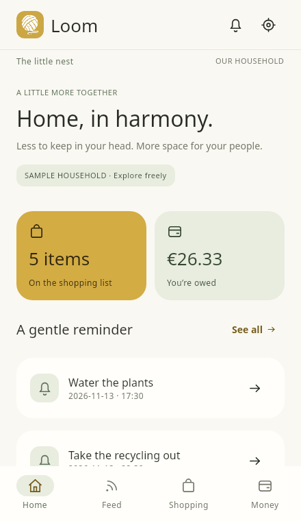
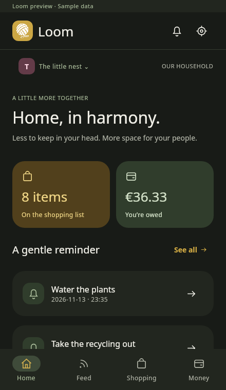

# Loom

**Life, woven together.** A Kotlin Multiplatform household companion for roommates and couples on Android and iOS, with shared Compose UI and a Supabase backend.

Application ID and iOS bundle ID: **`com.eyther.lumbridge`**.

 

## What’s included

- Household creation, owner invitations, and joining with one-time codes.
- A shared shopping list with quantities, categories, checked items, and live synchronization.
- Household reminders, daily/weekly repeats, timezone handling, and completion.
- Shared expenses with equal, exact-amount, and percentage splits; balances and repayments.
- Monthly recurring expense entries, monthly reports, category statistics, CSV export, and immutable statement revisions.
- RSS/Atom subscriptions with per-user read state and scheduled server refreshes.
- Light, dark, and system themes using the Loom gold and yarn branding.
- Supabase Edge Functions for FCM/APNs push delivery, retries, device rotation, and scheduled household work.
- A sample household that works without cloud configuration. Demo changes stay in memory for the session.

Recurring bills generate expense records; repayments record money you have already sent or received.

The [product roadmap](docs/product-roadmap.md) covers the agreed next improvements: multiple shopping lists, better editing and corrections, bill management, and shared responsibilities. Offline functionality is deferred.

## Architecture

Loom adapts [Plannot’s](https://github.com/Plannot/plannot-app) architecture and reuses its flow lifecycle helpers, navigation state, navigator, and transition wrappers:

```text
Host → Screen → ViewModel Contract + Implementation → UseCase → DataSource
```

There is one Gradle module per feature. `domain`, `data`, and `presentation` are **packages inside each feature**, with no layer-specific Gradle submodules.

```text
androidApp/                  Android application and FCM integration
iosApp/                      Native SwiftUI host, APNs delegate, Xcode project
desktopApp/                  Development preview for the shared UI
shared/
  core/                      Generic utilities, encrypted storage, transport, theme, navigation
  entrypoint/                Composition root, Koin bindings, navigation Hosts, iOS framework
  features/
    authentication/          domain/ · data/ · presentation/
    household/               domain/ · data/ · presentation/
    home/                    domain/ · presentation/
    shopping/                domain/ · data/ · presentation/
    reminders/               domain/ · data/ · presentation/
    expenses/                domain/ · data/ · presentation/
    feed/                    domain/ · data/ · presentation/
    insights/                domain/ · data/ · presentation/
    settings/                domain/ · data/ · presentation/
supabase/                    Versioned schema, functions, schedules, database integration tests
```

Screens collect lifecycle-aware state and pass individual values/callbacks to `Inner*Screen`. ViewModels use private `InnerInputState` and Plannot’s `observeWith` helpers. DataSource interfaces live in domain; `Common*` implementations own I/O. The composition root uses explicit Koin DSL factories bound to contracts, without annotation/code-generation submodules.

Models stay in their owning feature: household owns `HouseholdContextDomain`, expenses owns `MoneyDomain`, and other features depend on those domains directly. Core has no feature dependencies. Sample data, settings preferences, notification registration, statement exports, and app-specific routes also stay with their respective owners. See the ownership table in [architecture details](docs/architecture.md).

See [architecture details](docs/architecture.md) and [backend setup](docs/backend.md).

## Run

Use JDK 23, Android Studio with AGP 9.4 support, Android SDK 37, and Xcode on a Mac for iOS. Dependency versions are pinned in `gradle/libs.versions.toml`; the Gradle wrapper is included.

1. Open the repository in Android Studio.
2. Add your Android SDK path to `local.properties` if the IDE has not done so.
3. Run the `androidApp` configuration, or build:

   ```sh
   ./gradlew :androidApp:assembleDebug
   ```

The app uses Loom’s live project through `config/loom-public.properties`, which contains only its public URL and publishable client key. The welcome screen also offers a sample household without signing in. To use a different project, copy `loom.properties.example` to the gitignored `loom.properties`; environment variables override both files. Server secret keys are rejected by the build.

For iOS, open `iosApp/iosApp.xcodeproj`, select the **Loom** scheme, select your signing team, and run on an iOS 16+ simulator/device. Xcode builds the shared `LoomFoundation` framework through Gradle. A physical device and APNs credentials are needed for push delivery.

For the desktop development preview:

```sh
./gradlew :desktopApp:run
```

## Validate

```sh
./gradlew :shared:features:expenses:jvmTest \
  :shared:features:insights:jvmTest :shared:features:reminders:jvmTest \
  :shared:entrypoint:jvmTest :androidApp:assembleDebug
python3 tools/test_database.py
cd supabase/functions
deno task check
deno task test
```

The database test starts a disposable PostgreSQL container, applies the migrations, tests authorization and finance invariants, and removes the container. It never touches the hosted project. Compose tests exercise adding a shopping item, navigation, and theme switching; screenshots are saved under `build/screenshots`.

The existing Loom Supabase project is `eeyfhmlyopuobtgdfbql`. Its unused prototype was retired into a private `loom_legacy` schema; existing sign-in accounts were retained. The repository includes baseline markers for its five previous migrations so future migration history remains aligned.
