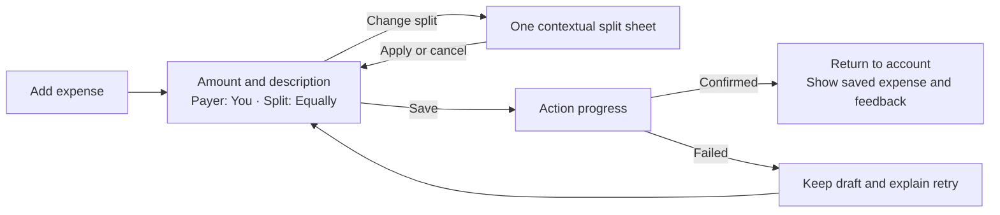

# Loom usability research and proposed design direction

16 November 2026. Proposal following the [captured redesign brief](../plans/redesign-research-brief.md).

## Recommendation

Use **Material 3** as Loom's coherent design system, applying its mobile layout, semantic color roles, typography, list, form and navigation guidance. Follow iOS guidance for platform interactions such as dismissal, safe areas and gestures. Use **Tricount for the shared-expense task model**, **Google Keep for checklist capture**, and **Todoist for progressive disclosure during quick capture**. These are focused behavioral references, not additional competing visual systems.

Loom already depends on Material 3. Installing another component library would leave the main problems intact. The work is to specify a consistent hierarchy, reduce unnecessary decisions and preserve useful content while data loads. Settle those choices in an expense-entry prototype and a Home/list prototype, then implement the shared components they actually need.

Start with expense entry and perceived responsiveness. Keep the household product scope, working KMP architecture and existing financial safeguards. A complete palette reset is available after the core layouts work.

## Evidence and limits

Reviewed source revisions:

| Project | Revision | Role in this comparison |
| --- | --- | --- |
| Loom | `a2fa148ab5eb5c5f6f239adfa10470312938c1b9` | Current implementation and stored preview captures |
| Original Lumbridge Android | `840d19ca7f72e01743c478eb7162bd912551283f` | Feature, component and interaction reference |
| Lumbridge KMP | `f2726a1f2f8d79d129ff96bea93e33a09445daff` | Earlier architecture/theme shell |

This is a source review, stored-capture review and online documentation study. It is not a measured live-server benchmark or a hands-on test of current Tricount/Keep releases. The stored Loom images use sample data; static captures establish layout issues, not frame timing, gesture behavior or production inset failures. Real Android/iOS measurements remain an implementation prerequisite.

## What to bring from the reference apps

| Reference | Observed implementation | Decision |
| --- | --- | --- |
| Original Lumbridge: theme | A small `4/8/16/24/32dp` spacing scale and a more complete light/dark Material color-role mapping, including surface-container roles | Adapt the token discipline and complete role mapping. Palette choice stays open. |
| Original Lumbridge: Feed | Locally persisted RSS subscriptions; source selection above an article list; article image/title/date; add/edit feed sheet | Adapt source management and article identity. Its local subscription storage is not proof of cached articles: article retrieval still uses a remote call. |
| Original Lumbridge: app shell | Bottom navigation reacts to IME visibility | Compare this behavior on a real keyboard. Preserve the intent without copying its inset-modifier stack wholesale. |
| Original Lumbridge: tools | Grouped entry points for shopping, reminders, recurring payments, notes and financial calculators | Keep relevant household destinations discoverable in More. Shopping/reminders/recurring payments already exist in Loom; this is not missing feature scope. |
| Original Lumbridge: personal finance | Financial profile, salary/net-salary, loans, breakdowns, monthly expenses and currency conversion | Defer unrelated calculators and profile complexity. Revisit only for a specific household need. Notes are a possible later feature, behind usability work. |
| Lumbridge KMP | Home is `Text("We're home!")`; navigation and theme providers are scaffolding | Reuse any useful token naming ideas. There is no finished feature experience here to migrate again. |
| Plannot | Existing Loom-adapted component, Host, state and package conventions | Continue to use the architecture and suitable components. Evaluate each UX behavior rather than assuming every borrowed loading policy suits Loom. |

Reference code: [original spacing](https://github.com/ruialmeida51/lumbridge-android/blob/840d19ca7f72e01743c478eb7162bd912551283f/presentation/src/main/java/com/eyther/lumbridge/ui/theme/Padding.kt), [original colors](https://github.com/ruialmeida51/lumbridge-android/blob/840d19ca7f72e01743c478eb7162bd912551283f/presentation/src/main/java/com/eyther/lumbridge/ui/theme/Color.kt), [Feed repository](https://github.com/ruialmeida51/lumbridge-android/blob/840d19ca7f72e01743c478eb7162bd912551283f/data/src/main/java/com/eyther/lumbridge/data/repository/news/NewsFeedRepositoryImpl.kt), [Feed screen](https://github.com/ruialmeida51/lumbridge-android/blob/840d19ca7f72e01743c478eb7162bd912551283f/presentation/src/main/java/com/eyther/lumbridge/features/feed/screens/FeedOverviewScreen.kt), [main shell](https://github.com/ruialmeida51/lumbridge-android/blob/840d19ca7f72e01743c478eb7162bd912551283f/presentation/src/main/java/com/eyther/lumbridge/launcher/screens/MainScreen.kt), [KMP Home](https://github.com/ruialmeida51/lumbridge-kmp/blob/f2726a1f2f8d79d129ff96bea93e33a09445daff/shared/features/home/presentation/src/commonMain/kotlin/screen/HomeScreen.kt).

## Concrete findings in Loom

### Expense capture waits before the user can type

[`GetExpenseFormUseCase`](../../shared/features/expenses/src/commonMain/kotlin/com/eyther/lumbridge/features/expenses/domain/usecase/GetExpenseFormUseCase.kt) requests the account, then household members, then the existing expense when editing. [`ExpenseFormScreen`](../../shared/features/expenses/src/commonMain/kotlin/com/eyther/lumbridge/features/expenses/presentation/screen/ExpenseFormScreen.kt) places description and amount inside `if (account != null)`. These are observable request dependencies and a UI gate, not evidence of how slow Supabase is.

Propose keeping the last successful account/member reference data scoped to the current user and household, and exposing draft inputs immediately. Refresh references in the background and validate authoritatively on save. Start independent reads together where that preserves policy and cancellation; do not make reference data globally shared just to avoid a request. Editing an existing expense still needs its actual record, with a distinct load/error state.

The current form already defaults payer to the current user, date to today and split to equal among account members. Preserve those working defaults; the opportunity is to make them available sooner and display them more compactly.

### Loading policy adds a deliberate floor and replaces useful content

[`delayAtLeast`](../../shared/core/src/commonMain/kotlin/com/eyther/lumbridge/core/coroutines/extensions/Delay.kt) and [`delayFirstAtLeast`](../../shared/core/src/commonMain/kotlin/com/eyther/lumbridge/core/coroutines/extensions/DelayFirst.kt) default to 300 ms. [`SupabaseAccess.watch`](../../shared/core/src/commonMain/kotlin/com/eyther/lumbridge/core/data/network/SupabaseAccess.kt) applies a minimum delay to its first read; several ViewModels also delay first emissions. Nested/concurrent timers may overlap: this does **not** establish a universal 600 ms cost.

Shopping explicitly renders skeletons for `loading || refreshing`, hiding its loaded rows during a manual refresh. This follows the current engineering rule, including the earlier user request for refresh skeletons. The proposal revisits that choice openly:

- First load with no content: a matching skeleton in the affected section.
- Refresh with existing content: retain rows, selection, focus and scroll; show the refresh indicator.
- Background updates: apply quietly without resetting the surface.
- Mutation: show action/row progress and appropriate success/error feedback.
- Fast completion: show the result promptly. If needed, delay the appearance of a loading indicator rather than delaying usable data.

Apple's loading guidance favors showing useful content promptly [S4]. NN/G describes skeletons as an aid to understanding content while it is unavailable [S6]; that does not require erasing available content. Any accepted policy revision must update `AGENTS.md`, `ai/` and `docs/design-language.md` together.

### Home currently waits for both feature streams

[`GetHomeOverviewStreamUseCase`](../../shared/features/home/src/commonMain/kotlin/com/eyther/lumbridge/features/home/domain/usecase/GetHomeOverviewStreamUseCase.kt) combines reminders, shopping and selection. It cannot emit an overview until each has emitted. Consider independent section states, so a shopping delay does not prevent reminder content from becoming useful. Adding Feed must not introduce another gate for the whole page.

### Repeated subscriptions deserve measurement

`SupabaseAccess.watch` reads initially, reloads after its realtime subscription becomes ready to repair a race, and polls every 30 seconds. Independent collectors can therefore create additional work. Measure subscription lifetimes and request counts when switching Home/Shopping/Balances and returning from forms. Share eligible reads within their owning feature and household scope where measurements justify it. Preserve the correctness repair for missed realtime events.

### Some responsiveness patterns already exist

[`ShoppingScreenViewModel`](../../shared/features/shopping/src/commonMain/kotlin/com/eyther/lumbridge/features/shopping/presentation/viewmodel/ShoppingScreenViewModel.kt) already tracks pending item changes and acknowledges versions. Enter-driven additions and stable server positions were implemented in the preceding pass. Preserve these; investigate remaining movement using keyboard/device captures and tracing rather than rebuilding the checklist or attributing every jump to unstable Compose lists.

### Information hierarchy remains expensive to scan

The stored [Home](../screenshots/home-light.png), [shopping preview](../screenshots/home-shopping-preview.png), [expense form](../screenshots/expense-form-light.png), [split sheet](../screenshots/split-shares-light.png) and [expense list](../screenshots/money-light.png) show:

- Large quick-action tiles and separate reminder cards put the shopping preview below the initial viewport. Keep the requested two quick actions; prototype a smaller footprint and fewer preview rows.
- The expense form gives amount, description, payer, split and participant breakdown similar visual weight. A simple equal split repeats information that could be summarized until opened.
- Split-method chips wrap into two rows; each participant then consumes a name/amount row plus a large input/control row. Compare a method selector and a compact participant row, expanding only when large text or input requires it.
- Expense rows have useful title, total, payer and personal share, but repeated independent rounded cards and ISO date headings weaken grouping. Compare open rows grouped by a human-readable date, with aligned amounts and quieter metadata.

These observations identify prototype candidates; changing every card into a flat list is not an evidence-based blanket rule.

### Theme roles and written rules need consolidation

[`LoomTheme`](../../shared/core/src/commonMain/kotlin/com/eyther/lumbridge/core/presentation/theme/LoomTheme.kt) overrides a subset of Material's color roles. Other roles inherit library defaults and can diverge from Loom's palette when components change. Generate and review a complete light/dark scheme, then use roles consistently.

The current design guide contains both older Today/Coming-up instructions and newer Reminders instructions, plus different refresh descriptions. Replace superseded sections when the new direction is accepted; do not append another layer of exceptions. Its original palette-preservation sentence is superseded by the user's authorization to reconsider colors.

## What the external references contribute

| Reference | Relevant finding | Application to Loom |
| --- | --- | --- |
| Tricount management and FAQ [S1, S2] | Contextual split editing through the equal-split control; an identified participant becomes the proposed payer for new expenses | Make common defaults effortless and advanced split editing optional. Keep all agreed split methods. |
| Keep lists [S3] | A checklist is the working surface; insertion order and checked items are explicit behaviors | Preserve continuous Enter-to-next-item capture, predictable order and completed-item management. |
| Todoist Quick Add [S7] | Start with task text and expose more actions as needed | Avoid a wall of optional reminder fields. This does not commit Loom to natural-language parsing. |
| Android content structure [S8] | A shared grid, aligned compact-screen margins, containment and consistent spacing aid readability | Adopt one spacing/row system; group related content without wrapping every item. |
| Apple sheets and modality [S5] | Sheets support scoped contextual tasks; one sheet at a time and clear dismissal keep the hierarchy understandable | Keep split editing contextual. Use a full destination for longer browsing/history rather than stacking sheets. |
| Apple loading [S4], NN/G response times [S9] | Prompt useful content and immediate interaction feedback preserve flow | Diagnose network gates and imposed waits. Response-time heuristics are not a promised server SLA. |
| Material typography and accessibility [S10, S11] | Semantic text roles and sufficiently large targets support scanning and interaction | Clear title/amount/metadata hierarchy; tabular money where supported; 48dp minimum shared touch targets. |

Tricount's documentation also covers payment-card onboarding, multiple currencies and an iOS-only calculator. Those do not become Loom requirements. Keep the agreed household membership and one-currency-per-account scope.

## Why choose Material 3

| Candidate | Fit and tradeoff |
| --- | --- |
| **Material 3 — recommended** | Established mobile guidance and components fit the existing Compose implementation. Apply the foundation and consistent usage; a new dependency is unnecessary. |
| Apple HIG as the whole visual system | Excellent guidance for iOS behavior and layout. An Apple-only specification would still require deliberate Android adaptation; use it to inform platform behavior within the shared product. |
| Fluent 2 | A real cross-platform design system. Its documented mobile implementations use separate Apple and Android libraries [S12]; adopting it would introduce a larger component-adaptation task without resolving Loom's request dependencies or information hierarchy. |

### Proposed Loom defaults

These are initial app choices for the prototype, not a claim that every number is mandated by Material.

| Concern | Proposed default |
| --- | --- |
| Spacing | Named `4, 8, 12, 16, 24, 32dp` scale; 16dp phone gutters; 8–12dp within a group; 24dp between unrelated sections. Android documents 16dp as a standard compact-screen margin [S8]. |
| Type | Material semantic roles; 16sp main row/body text, 14sp secondary text, a dominant amount only in money capture/summary. Support scaling without fixed text heights. |
| Touch targets | At least 48dp for shared interactive controls, including visually small checkbox/stepper icons [S11]. Avoid shrinking hit areas to achieve density. |
| Lists and surfaces | Open rows for repeated working items; a shared tonal surface for related settings; a card for a distinct summary or article. Use aligned leading/trailing columns. |
| Color | Complete semantic light/dark roles; neutral working surfaces, one primary action accent, semantic error/success indications. Evaluate the original warm palette and an alternative after the grayscale flow. |
| Shape | Follow component defaults initially; review one consistent container scale instead of assigning a new radius per feature. |
| Motion | Peer tab changes do not imply hierarchy. Forward/back transitions share one direction policy; system and toolbar Back reach the same destination. Honor reduced motion and verify platform gestures. |
| Forms | Required input first, optional details disclosed in context, visible validation, one primary submit action reachable above IME. Preserve input on retry/resume. |
| Actions | Filled primary actions; outlined/tonal secondary actions; accessible icon controls for frequent row actions. Destructive confirmations retain filled/outlined destructive buttons. |

## Representative flows to prototype

### A common shared expense

The initial prototype uses one focused expense destination, with one contextual split sheet. A sheet is not inherently faster than a screen; reducing choices and data gates matters more. Compare a compact capture-sheet variant only if it improves keyboard reachability, cancellation and editing without introducing stacked modals.

Example default view: `€24.00`, `Dinner`, `Paid by you`, `Split equally · 3 people`, `Today`, `Save expense`. Do not render three participant breakdown rows until they help a decision. Tapping split exposes equal/shares/exact/percentage and per-person results. Shares retain +/- controls and direct text entry; validate totals clearly for exact/percentage splits. Back/cancel discards only unapplied split changes.

First improve read reuse and capture readiness. If measured save latency still interrupts frequent use, evaluate an in-memory pending expense row with explicit saving/failed state and duplicate-write protection. Do not display a confirmed balance or success before the server accepts the transaction. This is a separate implementation decision, not an automatic commitment to offline writes.

### Home and Feed

Proposed content order: household/profile toolbar → compact expense/reminder quick actions → a short Reminders preview with plain-language dates → two or three shopping items with View all → optional News preview → full destinations in More.

Evaluate the existing square action preference in a more compact layout. Keep useful phrases, remove redundant headings and descriptions, and check what fits on a narrow phone without shrinking touch targets.

The News candidate is a manually scrolled row of roughly three initial stories with source, title and date; a partly visible next card suggests scrolling. Provide an explicit All news route, an image-failure layout and a way to hide the preview. It must not block reminders/shopping or auto-advance. This preview is a hypothesis to test, not settled Home scope.

For first use, offer an editable starter-source selection. Sources are configuration; articles still come from real feeds. Preserve the current household subscription scope unless a separate personal/household feed decision is made. Choose actual sources and locale before shipping a default catalog, check feed availability, and avoid making a busy setup wizard a prerequisite for using household tasks.

### Shopping and reminders

Retain the continuous checklist composer and its identity through Enter, acknowledgments and refresh. Align its checkbox/text with saved rows, keep the next entry above the keyboard, and retain completed-item bulk selection. Use local pending feedback already supported by the checklist.

Reminder capture starts with its title and useful date/time choices, with repeat/assignee/details secondary. Home is a preview with a clear route to all reminders. Completion feedback belongs to the action and a transient message; fetching a new recurring occurrence must not replace the entire page with skeletons.

## Prioritized work and acceptance checks

1. **Measure the actual paths.** Capture cold/warm startup, tab return, opening expense entry, opening/applying splits, save, five consecutive grocery entries and pull-to-refresh. Record time to first input, request count/duration, frame/layout movement and result feedback on Android/iOS. Use timing metadata, never financial values or descriptions. Report device/network conditions and distinguish real measurements from simulated latency.
2. **Prototype the core language.** Produce expense, split, Home and repeated-list states using the proposed tokens. Compare the compact alternatives with the current capture. Include no-content, stale-content, slow-read, error and keyboard states. Review these before changing every feature.
3. **Implement the accepted responsiveness policy.** Reuse eligible scoped reads, stop gating independent draft inputs, isolate Home sections and consolidate loading rules. A warm return should keep visible content and scroll; refresh should preserve drafts/selections. Money remains server-confirmed.
4. **Implement shared visual/interaction primitives.** Complete color roles, spacing/type usage, toolbar/selector placement, rows, feedback and one sheet layout. Validate Back and dismissal uniformly with IME open and closed.
5. **Apply to daily workflows.** Expense capture and split first, then Shopping and reminders/Home, then account/profile/More and secondary flows. Feed preview/catalog follows the selected Home prototype rather than driving the whole layout.
6. **Audit the final implementation.** Check feature/package ownership, typed errors, resource strings, central DI, Host boundaries, cancellation, stable row identity and Plannot-derived patterns. Reconcile written rules and remove superseded components/callbacks.

Behavioral acceptance:

- Warm expense capture allows immediate typing without a new reference-data read being a prerequisite.
- A common equal split needs amount/description and Save; defaults do not require navigating through participants.
- An unequal split is adjusted in one contextual editor and returns to the same expense draft.
- Five Enter submissions retain focus and visual alignment; acknowledgment order does not reorder rows.
- Manual refresh preserves useful loaded content, draft, selection and scroll under the proposed policy.
- Home features load independently and optional news does not delay household tasks.
- System Back, toolbar Back and platform gestures agree; resume preserves an in-progress form.
- Narrow screens, large text, light/dark, failed requests, long lists and real keyboard insets are verified.

This research changes documentation only. No production UI, rule file, schema, analytics event or release behavior is changed by this proposal.

## Documentation review

Local document/source links were checked. `python3 tools/audit_project.py` passed the existing package, boundary, DI, resource and screen-contract checks. Final review against the Plannot-derived checklist found no implementation changes to audit; recommendations that differ from existing rules are explicitly marked as proposals. App builds, device timing and comparative usability tests were not run for this documentation change.

## Online sources

Reviewed on 16 November 2026. Some Material/Apple pages require JavaScript in the text browser; indexed official excerpts were used for those pages, alongside readable official Android guidance. Product documentation describes intended behavior and does not prove comparative task speed.

- **S1:** [Tricount: managing accounts and expenses](https://help.tricount.com/articles/how-can-i-manage-my-tricounts-and-expenses).
- **S2:** [Tricount FAQs](https://help.tricount.com/articles/tricount-faqs).
- **S3:** [Google Keep: make a list](https://support.google.com/keep/answer/6395451?hl=en).
- **S4:** [Apple HIG: loading](https://developer.apple.com/design/human-interface-guidelines/loading).
- **S5:** [Apple HIG: sheets](https://developer.apple.com/design/human-interface-guidelines/sheets) and [modality](https://developer.apple.com/design/human-interface-guidelines/modality).
- **S6:** [NN/G: Skeleton Screens 101](https://www.nngroup.com/articles/skeleton-screens/).
- **S7:** [Todoist: Task Quick Add](https://www.todoist.com/help/todoist/features/use-task-quick-add-in-todoist-va4Lhpzz).
- **S8:** [Android: content composition and structure](https://developer.android.com/design/ui/mobile/guides/layout-and-content/content-structure).
- **S9:** [NN/G: response-time limits](https://www.nngroup.com/articles/response-times-3-important-limits/).
- **S10:** [Material 3: applying typography](https://m3.material.io/styles/typography/applying-type).
- **S11:** [Android accessibility: touch-target size](https://support.google.com/accessibility/android/answer/7101858?hl=en).
- **S12:** [Fluent 2: platform libraries](https://fluent2.microsoft.design/get-started/develop).
- Additional system references: [Material 3 foundations](https://m3.material.io/foundations/), [Material mobile theme guidance](https://developer.android.com/codelabs/m3-design-theming), [Material spacing](https://m3.material.io/foundations/layout/grids-spacing/spacing), [Material bottom sheets](https://m3.material.io/components/bottom-sheets/guidelines), [Tricount custom splits](https://www.tricount.com/features/custom-split-expenses), [Splitwise split methods](https://kb.splitwise.com/balances-and-expenses/what-are-different-ways-i-can-split-an-expense).
